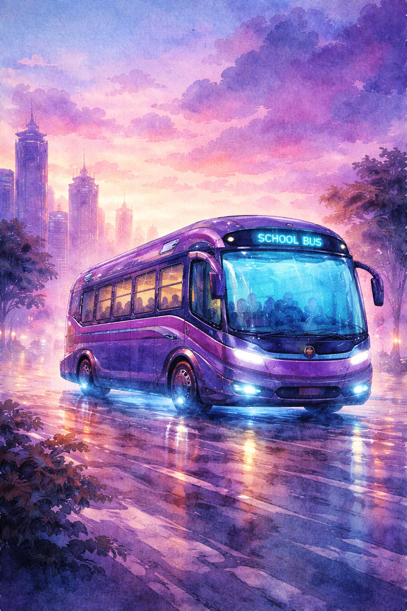
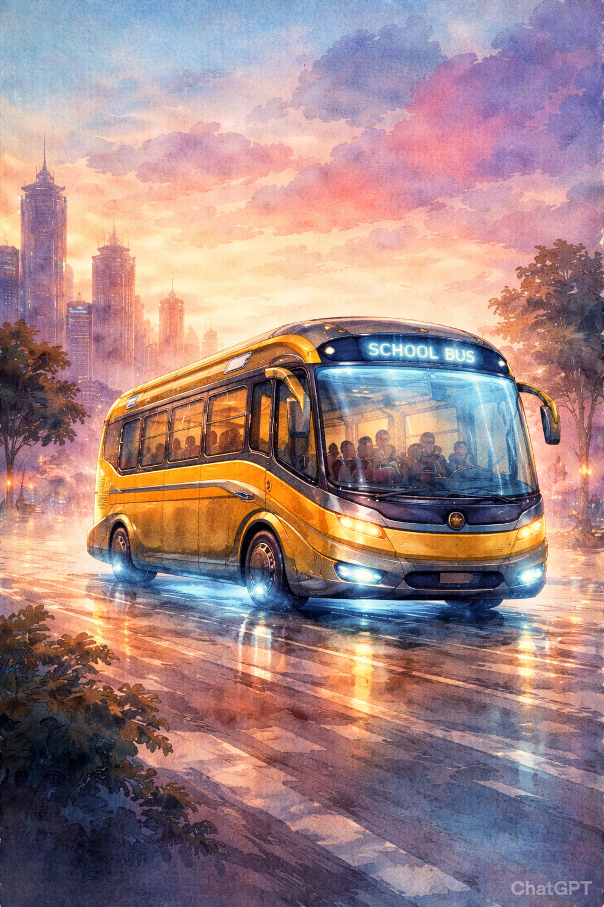

# Objective:
Create prompts for models that generate images.

Write a descriptive prompt for an image model (e.g., "A futuristic city skyline at sunset in watercolor style.").

## Prompt:

A futuristic moving school bus at dawn in watercolor style.

## Model Output:

## prompt: 
A futuristic moving school bus at  dawn with yellow color and a light blue screen in watercolor style.

## Model output:

## Compare results between a vague prompt and a refined descriptive prompt.

    The vague prompt is not specific, while the refined prompt is specific.
